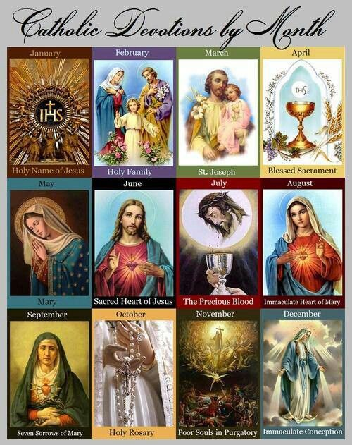

- **January:** The Most Holy Name of Jesus – Honoring the sacred and powerful name of Jesus.
- **February:** The Holy Family – Reflecting on Jesus, Mary, and Joseph as a model of domestic life and virtue.
- **March:** Saint Joseph – Devotion to the foster father of Jesus and guardian of the universal Church.
- **April:** The Holy Eucharist / Blessed Sacrament – Centering on the Real Presence of Christ in the Eucharist.
- **May:** The Blessed Virgin Mary – Honoring Our Lady through May crownings and daily rosaries.
- **June:** The Sacred Heart of Jesus – Focusing on Christ's divine love and mercy symbolized by His physical heart.
- **July:** The Most Precious Blood of Jesus – Meditating on the saving blood Christ shed for humanity.
- **August:** The Immaculate Heart of Mary – Honoring the purity and sorrow/joy of the Virgin Mary's heart.
- **September:** Our Lady of Sorrows (The Seven Dolours) – Reflecting on Mary's grief during the Passion and death of Jesus.
- **October:** The Holy Rosary – Dedicated to Our Lady of the Rosary and deep meditative prayer.
- **November:** The Holy Souls in Purgatory – Praying for the faithful departed, especially during the month starting with All Souls' Day.
- **December:** The Immaculate Conception / Advent & The Nativity – Preparing for the coming of Christ and honoring Mary's conception free from original sin.
